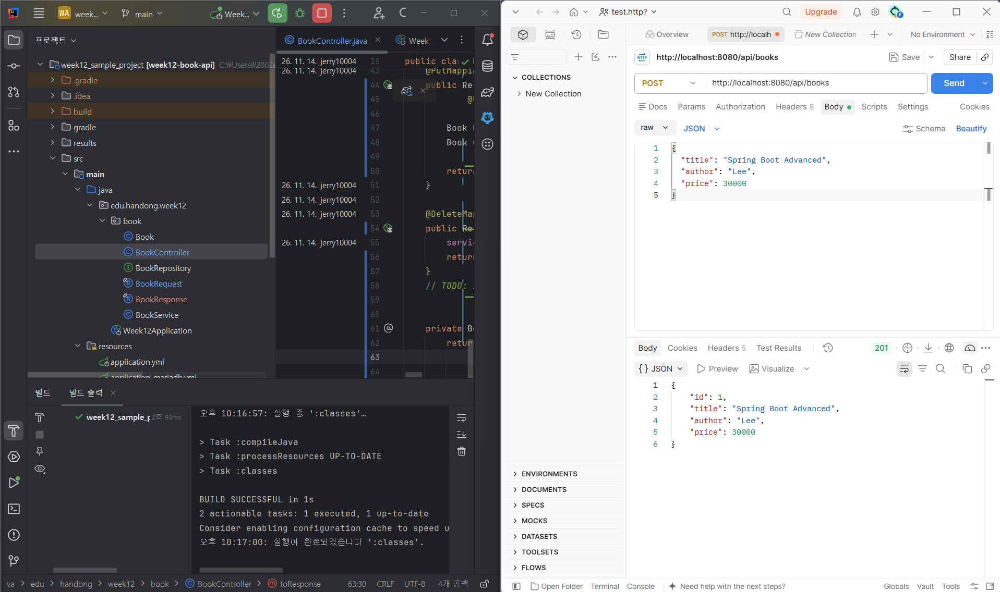
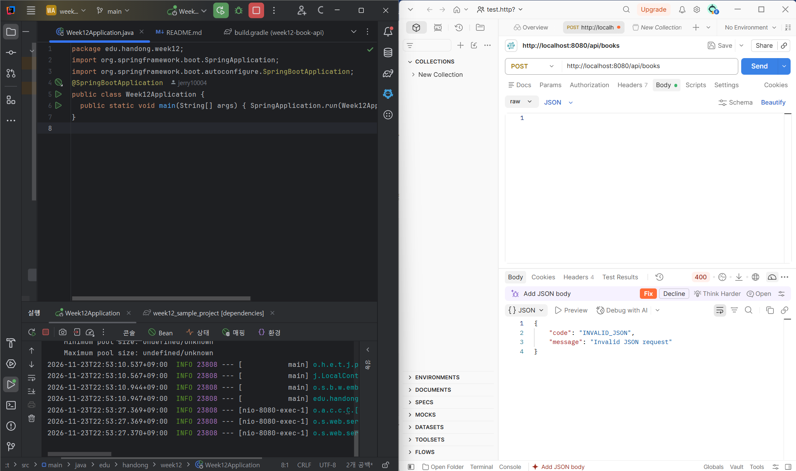

# 웹서비스 개발 01분반 12주차 22200543 이어진

## 1. Project Information: 프로젝트 소개, GitHub URL, Render URL

프로젝트 소개 : 도서 관리 프로그램 (REST API 기반)
구체적 구현 - DTO를 활용하여 요청과 응답 데이터를 분리하고, ResponseEntity를 통해 HTTP 상태 코드를 명확하게 반환하도록 설계.  
그리고 Validation을 통한 예외 처리, Pagination과 Sorting 기능을 추가하고 Swagger를 통해 API 문서를 자동으로 생성하도록 구현 
조직 GitHub URL : https://github.com/2026-2-WebService/assign12-c01-22200543 
개인 GitHub Repository URL : https://github.com/eojinleecode/22200543-assgin12     
Render URL : https://two2200543-assgin12.onrender.com/api/books 

## 2. Installation: Java/DB 환경과 실행 방법

Language Java 17  
Framework Spring Boot 3.5.7  
Build Tool Gradle 8.x  
IDE IntelliJ IDEA  
Database H2, MariaDB  
ORM Spring Data JPA  
API Testing Postman, Swagger UI  
Deployment Docker, Render  

## 3. Source Code Exploration: 분석 질문 8개 답변, 주석 작성한 메서드 3개
* Project Structure & JPA

1. BookController, BookService, BookRepository의 역할과 요청 처리 흐름을 설명하세요. 
BookController : 클라이언트의 HTTP 요청을 수신 
BookService : 핵심 비즈니스 로직을 처리 
BookRepository : 데이터베이스와 직접 통신하여 데이터를 조회, 저장, 수정, 삭제(CRUD)하는 역할 
요청 처리 흐름 : BookController <-  BookService < - BookRepository 
2. JpaRepository<Book, Long>만 선언해도 findAll(), save()를 사용할 수 있는 이유를 설명하세요. 
   인터페이스 상속 구조와 Spring Data JPA에 의해 기본 기능 자동적으로 사용  
* DTO & HTTP Response

3. 기존 API가 Book Entity를 직접 요청·응답에 사용할 때 발생할 수 있는 문제를 설명하세요.
   엔티티의 필드명이나 구조를 변경하면 API 스펙이 그대로 바뀌어 클라이언트와의 하위 호환성이 깨질수 있다.
4. Request DTO와 Response DTO를 분리하는 이유와 ResponseEntity가 필요한 상황을 설명하세요.
   입력 검증(@NotBlank, @Min 등)은 Request DTO에, 응답 포맷팅과 직렬화 제어는 Response DTO에 집중시켜 변경의 영향을 최소화시킬수 있다. 
* Validation & Exception Handling

5. @Valid, @NotBlank, @Min은 각각 어느 시점에 어떤 동작을 수행하나요?
   @Valid: 컨트롤러 메서드를 선언. RequestResponseBodyMethodProcessor가 JSON을 DTO로 부른후,
   컨트롤러 메서드 본문이 실행되기 전에 Validator를 호출해 검증을 수행. 
@NotBlank: @Valid가 검증을 트리거하는 시점에 동작. 대상 String 필드가 null이 아니고, 빈 문자열이 아니며, 공백 문자만으로 이루어지지 않았는지 검사  
@Min: 마찬가지로 @Valid 검증 시점에 대상 숫자 필드가 지정된 최솟값 이상인지 검사.. null 값은 유효한 것으로 통과하므로 필수 값이라면 @NotNull과 함께 사용. 
6. @RestControllerAdvice와 @ExceptionHandler를 사용하면 예외 처리 흐름이 어떻게 바뀌나요?

컨트롤러나 하위 계층(Service, Repository)에서 예외가 발생. 
DispatcherServlet이 예외를 알림, ExceptionHandlerExceptionResolver에게 처리를 넘긴다. 
@RestControllerAdvice가 선언된 전역 예외 처리 클래스에서 발생한 예외 타입(또는 상위 타입)과 일치하는 @ExceptionHandler 메서드를 찾아 실행. 
해당 메서드가 반환한 공통 에러 DTO와 HTTP 상태 코드가 JSON으로 직렬화되어 클라이언트에 응답 

* Pagination & OpenAPI

7. Pageable과 Page<T>는 각각 어떤 역할을 하며 sort=price,desc는 어떻게 처리되나요?
   Pageable, Page<T>의 역할과 sort=price,desc 처리 과정 
   Pageable (요청 정보): 클라이언트가 전달한 페이지 번호(page), 페이지 크기(size), 정렬 조건(Sort)을 담는 인터페이스.  
컨트롤러 파라미터로 선언하면 PageableHandlerMethodArgumentResolver가 쿼리 파라미터를 자동으로 바인딩. 
Page<T> (응답 결과): 조회된 현재 페이지 데이터(content)와 함께 전체 데이터 수(totalElements), 전체 페이지 수(totalPages), 
다음 페이지 존재 여부 등 페이징 메타데이터를 담는 객체. 전체 개수를 구하기 위해 내부적으로 COUNT 쿼리가 추가로 실행. 

sort=price,desc 처리 과정:
SortHandlerMethodArgumentResolver가 객체 변환  
Spring Data JPA가 Repository 쿼리를 생성할 때 Pageable의 정렬 정보를 읽어 엔티티의 price 필드 기준으로 DB에 실행
 
8. /v3/api-docs와 /swagger-ui.html의 역할을 구분해서 설명하세요.
   /v3/api-docs의 역할 : 애플리케이션의 컨트롤러와 DTO를 분석해 생성한 OpenAPI 3.0 명세 원본(JSON) 제공  
   /swagger-ui.html의 역할 : JSON 데이터를 읽어 사람이 보기 편한 웹 UI 문서로 렌더링  

## 4. Refactoring: DTO와 ResponseEntity 변경 전/후

변경 전 : BookRequest와 BookResponse DTO를 생성,전달하는 데이터와 서버가 반환하는 데이터를 구분.  
변경 후 : ResponseEntity를 적용하여 각 HTTP Method에 적절한 상태 코드를 반환하도록 수정  

## 5. New Features: Validation, 공통 예외 처리, Pagination/Sorting, Swagger

* Swagger UI와 OpenAPI를 적용함 

build.gradle에 springdoc-openapi 의존성을 추가하고, BookController에 @Tag와 @Operation 어노테이션을 적용하여 간단한 API 설명. 

@Tag: API 그룹의 이름 및 설명 지정 

@Operation: 개별 API의 기능 및 동작 설명 

## 6. Testing & Deployment: results/ 스크린샷 6장 이상 및 배포 URL

* API 테스트 화면

* DTO 적용 후 POST 성공

* 잘못된 입력 요청

* 존재하지 않는 ID

* 페이지/정렬 적용 결과

* Swagger UI/API 테스트 화면

## 7. Weekly Review: 새롭게 배운 내용 3가지, 어려웠던 점과 해결 방법, AI 활용 내용 및 느낀 점
* 새롭게 배운 내용 3가지: validation을 통한 404 예외처리, @Tag 어노테이션 기능,   Pagination의 역할  
* 어려웠던 점과 해결 방법 : 
* AI 활용 내용 및 느낀 점 :