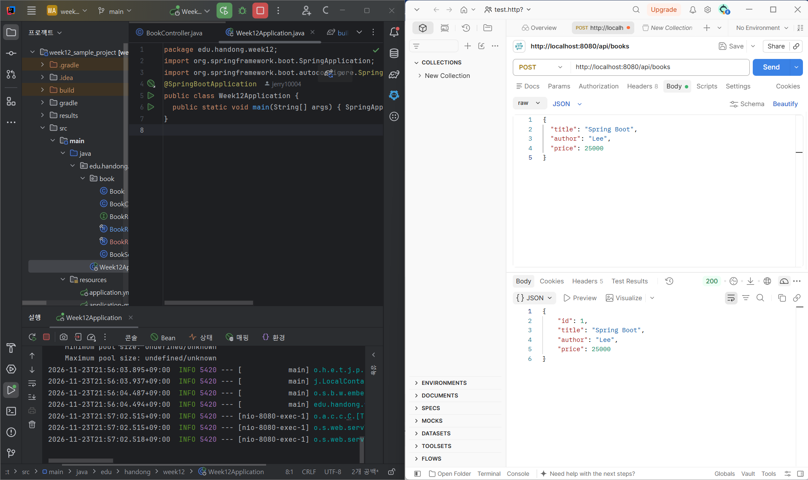
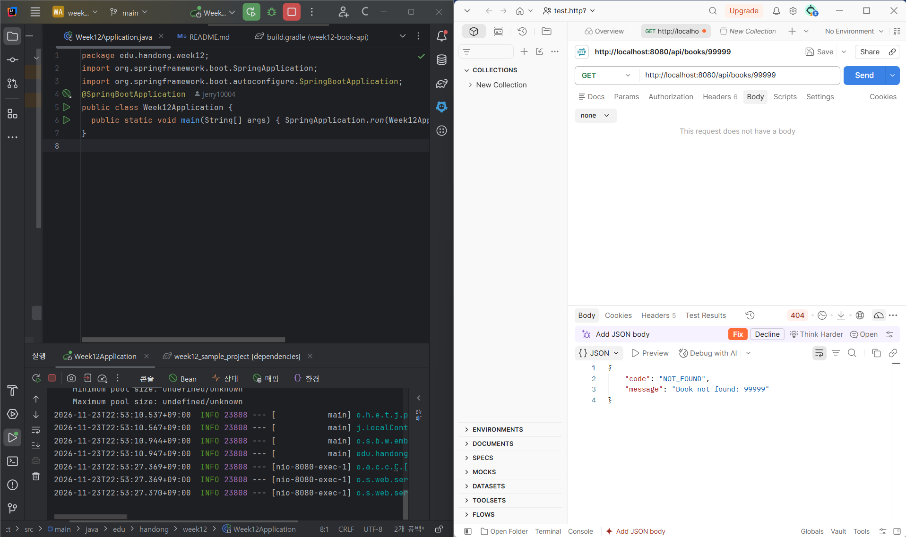
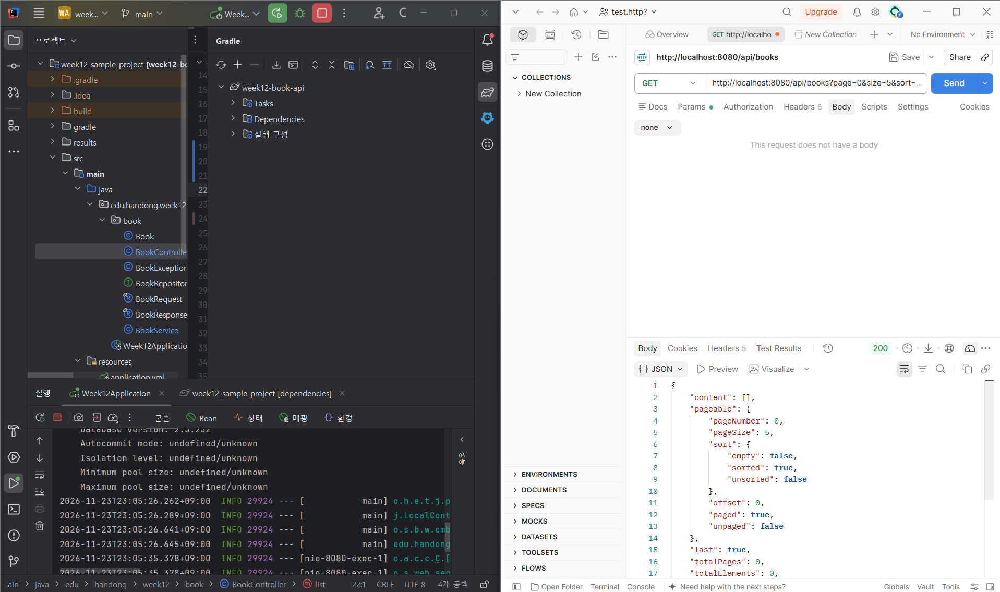
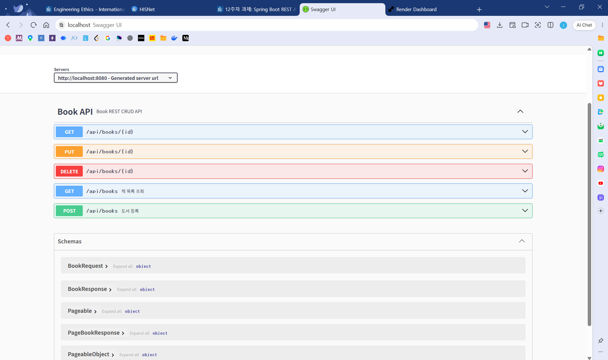

# 웹서비스 개발 01분반 12주차 22200543 이어진

## 1. Project Information: 프로젝트 소개, GitHub URL, Render URL
프로젝트 소개 :
조직 GitHub URL : https://github.com/2026-2-WebService/assign12-c01-22200543
개인 GitHub Repository URL : https://github.com/eojinleecode/22200543-assgin12    
Render URL : https://two2200543-assgin12.onrender.com/api/books

## 2. Installation: Java/DB 환경과 실행 방법

## 3. Source Code Exploration: 분석 질문 8개 답변, 주석 작성한 메서드 3개
* Project Structure & JPA

1. BookController, BookService, BookRepository의 역할과 요청 처리 흐름을 설명하세요.

2. JpaRepository<Book, Long>만 선언해도 findAll(), save()를 사용할 수 있는 이유를 설명하세요.

* DTO & HTTP Response

3. 기존 API가 Book Entity를 직접 요청·응답에 사용할 때 발생할 수 있는 문제를 설명하세요.

4. Request DTO와 Response DTO를 분리하는 이유와 ResponseEntity가 필요한 상황을 설명하세요.

* Validation & Exception Handling

5. @Valid, @NotBlank, @Min은 각각 어느 시점에 어떤 동작을 수행하나요?

6. @RestControllerAdvice와 @ExceptionHandler를 사용하면 예외 처리 흐름이 어떻게 바뀌나요?

* Pagination & OpenAPI

7. Pageable과 Page<T>는 각각 어떤 역할을 하며 sort=price,desc는 어떻게 처리되나요?

8. /v3/api-docs와 /swagger-ui.html의 역할을 구분해서 설명하세요.

## 4. Refactoring: DTO와 ResponseEntity 변경 전/후

## 5. New Features: Validation, 공통 예외 처리, Pagination/Sorting, Swagger

## 6. Testing & Deployment: results/ 스크린샷 6장 이상 및 배포 URL

* API 테스트 화면

* DTO 적용 후 POST 성공

* 잘못된 입력 요청

* 존재하지 않는 ID

* 페이지/정렬 적용 결과

* Swagger UI/API 테스트 화면

## 7. Weekly Review: 새롭게 배운 내용 3가지, 어려웠던 점과 해결 방법, AI 활용 내용 및 느낀 점
* 새롭게 배운 내용 3가지:
* 어려웠던 점과 해결 방법: 
* AI 활용 내용 및 느낀 점 :